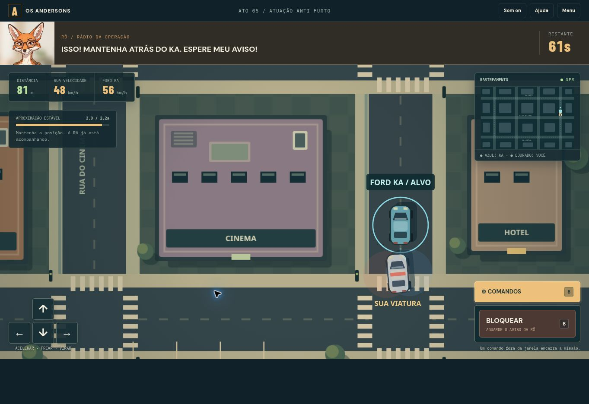
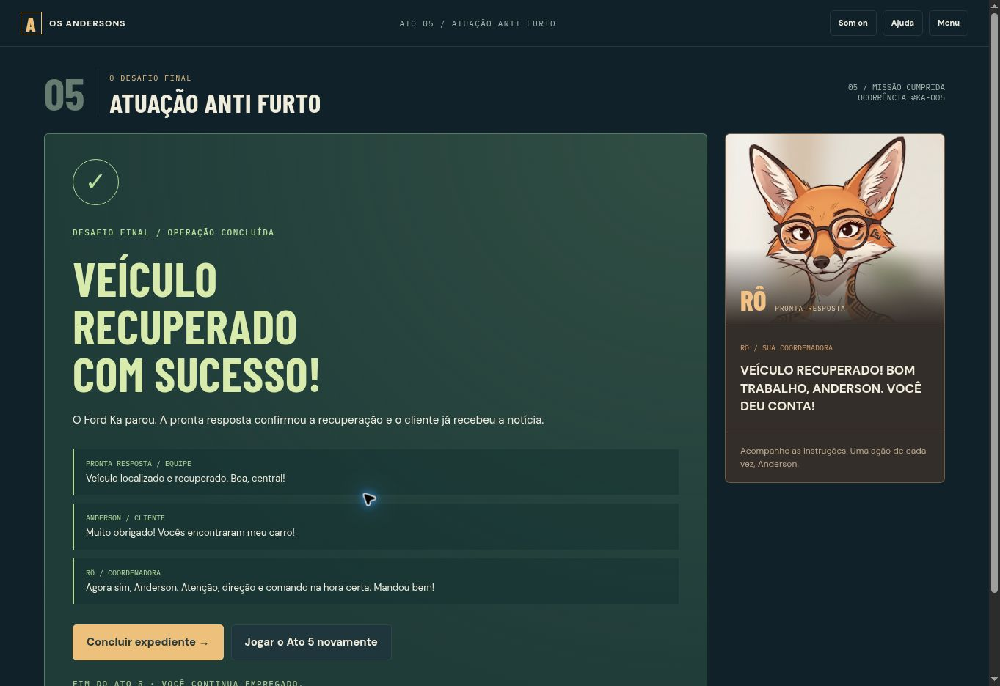
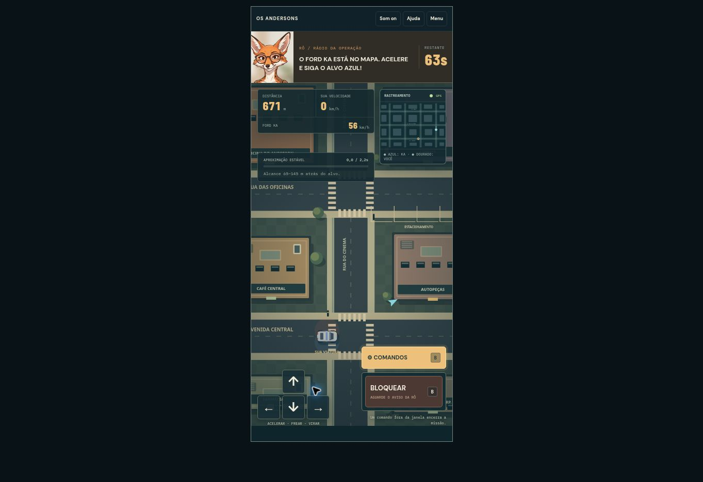

# Ato 5 — Atuação anti furto

Versão 0.6. O mesmo expediente continua após O grande roubo. O botão do encerramento do Ato 4 e saves antigos concluídos daquele ato abrem o novo desafio. O menu também oferece uma partida isolada, preservando o progresso da campanha.

## Atendimento e classificação

O alerta inicial “FUI ROUBADO” ocupa o quadro principal em vermelho, com pulsação de borda. As cinco respostas seguem o roteiro de Luan; apenas “Como ocorreu, senhor?” permite continuar. As demais mostram a Cat demitindo o jogador. O relato do cliente permanece visível na escolha entre FURTO e ROUBO.

Neste cenário, o cliente deixou o carro diante de casa e percebeu o desaparecimento duas horas depois. A classificação esperada é furto, inferida das informações apresentadas. Escolher roubo inicia a capacitação da Rô, sem demissão.

A bronca tem 28 páginas e aproximadamente 2.700 palavras. Cada página exige avanço manual, pelo menos cinco segundos de tempo ativo e rolagem até o final, quando o texto não cabe no quadro. Não há botão de pular. A última página retorna à mesma pergunta. Uma nova escolha errada reinicia a bronca. O save da campanha preserva a página atual; o jogo não consegue verificar leitura cognitiva, apenas a exibição e o avanço das páginas.

As definições nas páginas 3–5 foram conferidas em 24/10/2026 em fontes oficiais. Os demais parágrafos são reprimendas, analogias e burocracia inteiramente ficcionais:

- [Senado Federal — Furto, referência ao art. 155](https://www12.senado.leg.br/manualdecomunicacao/guia-juridico/furto).
- [Senado Federal — Roubo, referência ao art. 157](https://www12.senado.leg.br/manualdecomunicacao/guia-juridico/roubo).

O contraste usado é ausência de violência/grave ameaça na subtração versus a presença desses elementos contra uma pessoa, ou a supressão da possibilidade de resistência. A classificação do cenário não se apoia apenas no fato de o cliente estar ausente. Não são apresentadas penas ou orientações para um caso real.

## Rastreamento e pronta resposta

Após a classificação correta, o jogador abre a plataforma. O Ford Ka percorre uma rota contínua pela mesma cidade do ato anterior. O mapa mostra posição e direção, enquanto endereço, setor, coordenadas fictícias e número da atualização mudam.

O jogador deve copiar a localização, selecionar Pronta resposta, colar a mensagem completa e enviar. A cópia é um instantâneo, válido por 12 segundos de jogo ativo. Uma mensagem alterada, antiga ou no contato errado recebe orientação para correção; esses erros de preparação não encerram a missão. Os botões de copiar/colar internos funcionam mesmo sem permissão para acessar o clipboard do navegador.

Todo o WhatsApp, a equipe, as posições e os comandos são locais e fictícios. Nenhuma mensagem é enviada a pessoas reais e não há conexão com equipamento físico ou plataforma de monitoramento.

## Perseguição final

Depois de uma instrução curta e uma contagem de três segundos, o jogador assume uma viatura. A posição do alvo continua da etapa de rastreamento; a viatura começa 350 unidades de percurso atrás dele. O Ford Ka segue uma rota com curvas arredondadas. O jogador dirige livremente, com colisões de construções e limites da cidade.

| Regra | Valor |
| --- | --- |
| Prazo ativo da operação | 70 segundos |
| Distância para estabelecer aproximação | 65–145 m fictícios |
| Posição | Atrás do Ka, lateral inferior a 42 unidades |
| Alinhamento inicial | Diferença de direção inferior a aproximadamente 28° |
| Diferença de velocidade | Até aproximadamente 17 km/h fictícios |
| Tempo de estabilidade | 2,2 segundos |
| Janela única de bloqueio | 1,5 segundo |
| Proximidade tolerada durante a janela | 42–175 unidades, ainda atrás e alinhado |

A barra de aproximação enche quando as condições são atendidas e recua quando se perde o acompanhamento. Ao completar, a Rô chama “AGORA!”, a mensagem central aparece, o botão muda para verde, uma barra de tempo diminui e há um sinal sonoro. A janela começa quando a aproximação está pronta; não depende de abrir o painel de comandos. É preciso deixá-lo preparado antes.

Enviar BLOQUEAR antes da janela, perder a oportunidade ou deixar os 70 segundos terminarem encerra a operação. Colidir reduz a velocidade e dá uma orientação; não causa derrota imediata. O comando correto desacelera o alvo, confirma a recuperação e exibe os agradecimentos da equipe e do cliente e o elogio da Rô.

No PC: WASD/setas dirigem, Espaço freia e B abre Comandos ou envia BLOQUEAR se o painel já estiver aberto. No celular: setas aceitam ponteiros simultâneos e permanecem à esquerda; Comandos/BLOQUEAR ficam à direita. A Rô, o relógio, a estabilidade e o rastreamento reduzido permanecem visíveis na perseguição. A ajuda pausa o relógio. Troca de aba e perda de foco também pausam e exigem retomar explicitamente a corrida.

## Estado, imagem e implementação

A foto de Rô é o JPEG original enviado por Luan, em `dist/assets/ro.jpeg`; a interface apenas enquadra a imagem com CSS. A cidade e os veículos reaproveitam o desenho original em Canvas 2D do Ato 4. A rota, o rastreamento SVG e a interface são código do projeto. Não há novas dependências ou alteração na oficina 3D.

As regras estão em `recovery-core.mjs`, o texto em `ro-lecture.mjs`, a arte em `recovery-art.mjs` e a interface em `recovery.mjs`/CSS/HTML. A simulação usa relógio independente do desenho, com pausa explícita e limpeza de entradas ao interromper a partida. O progresso não depende de requestAnimationFrame.

Saves locais separados guardam campanha e modo isolado. O restaurador valida caso, etapa, página, mensagens, posições e pré-requisitos de vitória. Uma falha na campanha encerra o expediente. Repetir o ato após vencer abre uma partida isolada e conserva a campanha concluída. A ponte de frames valida origem, janela emissora e tipo de mensagem.

## Verificação

Os testes incluem todas as respostas do atendimento, classificação, passagem obrigatória pelas 28 páginas, texto e validade da localização, destinatário, continuidade e colisões da rota, direção, aproximação, abertura da janela, bloqueios antecipado/tardio/correto, prazo, retomada e integração com saves antigos do Ato 4. Também verificam preservação da campanha ao jogar isoladamente ou repetir uma vitória, encaminhamento da preferência de som e rejeição de mensagens de outros frames/origens. As regressões dos quatro atos anteriores e da prática LCV5 permanecem na suíte.

No navegador, o fluxo correto foi percorrido até “VEÍCULO RECUPERADO COM SUCESSO” usando aceleração, freio e curvas por teclado. A ajuda foi usada para pausar e inspecionar a aproximação durante a verificação. Também foram conferidas a demissão inicial, as primeiras páginas e o bloqueio de avanço da bronca, a correção de destinatário da localização e a derrota por bloqueio antecipado. A leitura completa e o retorno da bronca são cobertos pelas regras automatizadas.

Testes de largura de celular usam um quadro de 390 × 844 pixels; não substituem testes em aparelhos físicos. Registros da perseguição e do encerramento acompanham este documento.

Resultado: 67 testes automatizados aprovados (48 anteriores, 12 de regras do Ato 5 e 7 novos de integração). A largura de 390 pixels ficou sem transbordamento horizontal. A área da corrida ocupa 696 pixels dos 844 disponíveis, com guia e cabeçalho acima; acelerador por toque prolongado, controles e abertura de Comandos foram conferidos. Não foram observados erros de execução originados pelo jogo.

