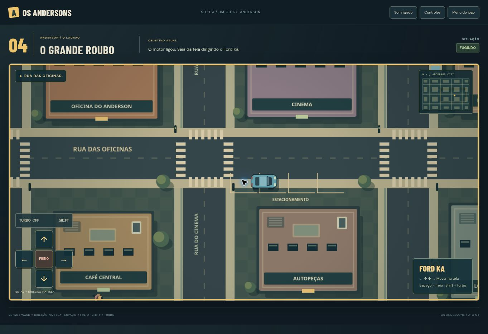

# Correção dos controles — 1.0.1

O modelo anterior tratava ↑ como acelerador, ↓ como freio/ré e os lados como rotação relativa. Isso fazia a mesma tecla produzir direções diferentes conforme a orientação do carro.

A partir desta versão, ambos os carros usam direção absoluta na tela, com o mesmo mapa de teclas e botões:

| Controle | Movimento |
| --- | --- |
| ↑ ou W | Para cima da tela |
| ↓ ou S | Para baixo da tela |
| ← ou A | Para a esquerda da tela |
| → ou D | Para a direita da tela |
| Espaço ou FREIO | Parar, sem ré |
| Shift ou Turbo | Maior velocidade enquanto há direção |

A frente do veículo se ajusta automaticamente. Soltar uma direção mantida interrompe o movimento. Um toque curto recebe até 140 ms adicionais de movimento no relógio normal, sem adiantar o mundo ou consumir tempo extra da perseguição. Teclas novas têm prioridade sobre esse complemento. Dois dedos permitem diagonais e o freio prevalece sobre o movimento. Cancelamento de toque e perda de foco limpam a entrada.

O Ford Ka usa velocidade normal de 260 unidades e Turbo de 365. A viatura usa 180 e Turbo de 310; a velocidade normal permite acompanhar o alvo e completar a aproximação. A janela de bloqueio e os demais desafios permanecem. As colisões continuam ativas.

## Verificação

- Testes das quatro direções dos dois veículos com quatro orientações iniciais, incluindo velocidade negativa de saves antigos.
- Testes de WASD/setas, freio, parada sem movimento residual, diagonais, Turbo, toques e entradas simultâneas.
- Uma perseguição completa desde a largada, usando apenas as novas direções e Turbo, até o bloqueio e a vitória.
- Navegador: quatro setas no Ford Ka e WASD na viatura. O minimapa confirmou os sinais esperados de X/Y.
- Em quadro de 390 pixels: toque para cima, baixo e esquerda confirmados; sem transbordamento horizontal. A verificação prolongada terminou pelo prazo normal da missão.

Entradas, páginas e módulos atualizados recebem versão na URL para carregar a correção após atualizar a página.

