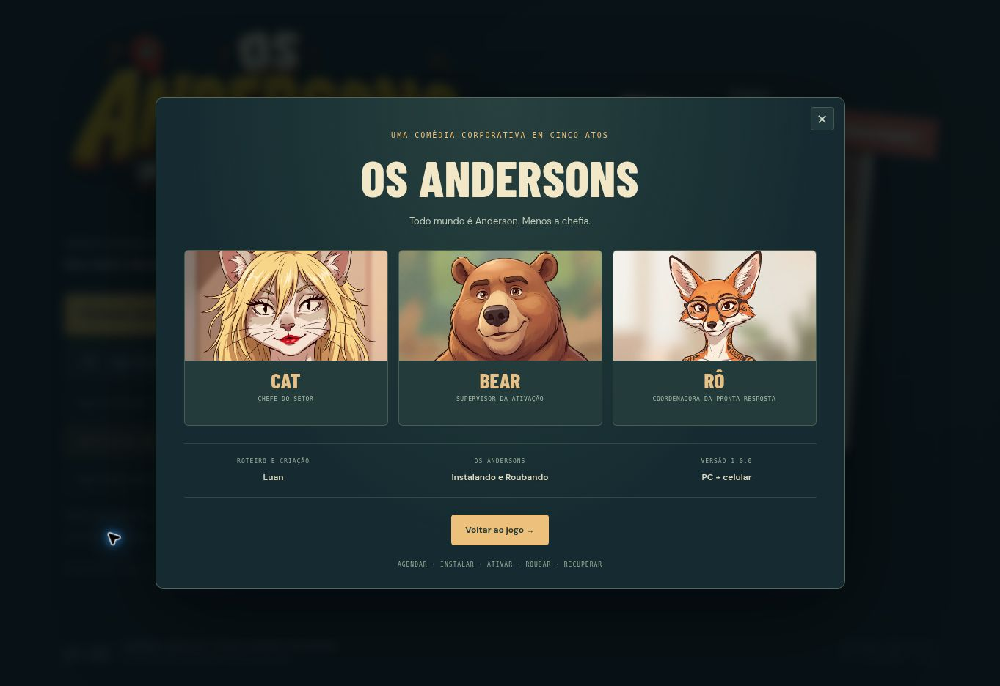

# OS ANDERSONS — Versão 1.0.0

24 de outubro de 2026. Campanha individual de cinco atos concluída.

## Fechamento

- Menu com versão final e créditos de Cat, Bear e Rô. Roteiro e criação creditados a Luan.
- Recuperação concluída oferece um encerramento com os três personagens e retorno ao menu ou repetição isolada do desafio final.
- Campanha finalizada permanece registrada no menu, com opção de rever o final sem apagar o progresso.
- Missão isolada e campanha completa recebem textos diferentes; jogar somente o Ato 5 não afirma que os cinco atos foram concluídos.
- Metadados de título, descrição e imagem preparados para compartilhar o endereço do jogo.

## Verificação

70 testes aprovados: os 67 da versão anterior, um teste de créditos e dois testes da interface de encerramento. O teste da campanha concluída passou a validar a opção de rever o final e a preservação do estado de conclusão. As regras e os cinco atos permanecem cobertos pela suíte.

No navegador: abertura e fechamento dos créditos pelo menu no PC; os mesmos créditos em quadro de 390 × 844 pixels, sem transbordamento horizontal; retorno ao menu e entrada no Ato 5. Não foram observados erros originados pelo jogo. O fluxo do encerramento após vitória e o fechamento do modal ao repetir são exercitados na integração da interface. A corrida completa até a recuperação foi conferida na versão anterior; as regras de direção e bloqueio permanecem iguais.

Uma verificação dos arquivos estáticos não encontrou os padrões conhecidos de chaves Google, GitHub, OpenAI, AWS, chaves privadas ou tokens Bearer. O jogo utiliza dados e comandos fictícios. O acesso da publicação é administrado pelo Sites, separadamente do código.

